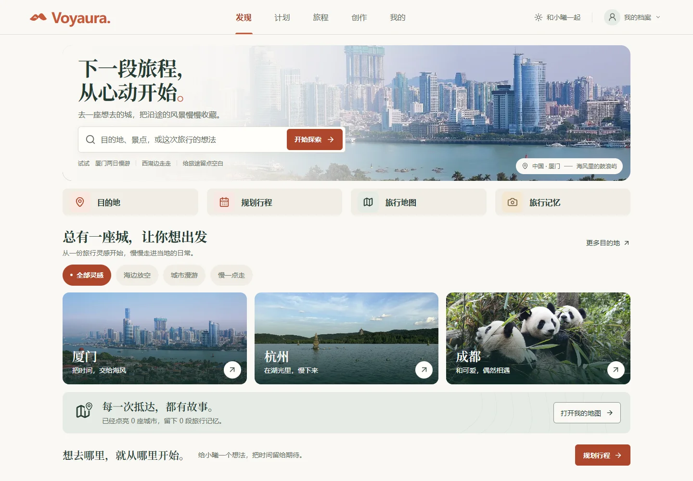

# Voyaura

以地图与私人旅行记忆为核心的旅行应用。当前界面为用户选定的 **289fd4d** 四图构图版；本交付基于 Listen167/main **567dfde** 整合，保留其新增正式行程、模型需求接口和API模块，不覆盖维护者后续开发。

## 本地启动

推荐 Python3.12、Node24 LTS；浏览器验收需要Chrome。

~~~powershell
uv venv api/.venv --python 3.12
uv pip install --python api/.venv/Scripts/python.exe --default-index https://pypi.org/simple --require-hashes -r api/requirements-dev.lock
npm --prefix web ci
api/.venv/Scripts/python.exe scripts/local_setup.py
~~~

分别在两个终端运行：

~~~powershell
api/.venv/Scripts/python.exe scripts/local_serve.py api
~~~

~~~powershell
api/.venv/Scripts/python.exe scripts/local_serve.py web
~~~

默认Web5188/API8018，只监听127.0.0.1。首页可直接浏览；私人入口从本机.local/access-token.txt复制令牌连接。初始化只创建用户和城市字典，重复运行不覆盖凭证。真实令牌、环境、数据库和媒体不随源码交付。

## 当前能力

- 旅行目标、城市、时间和预算→用户地点或授权查询→每日草案、地图联动、来源与未知提示→编辑→主动确认保存。
- 授权所选城市和日期的已有记录→本地整理文字、日期与可用影像数量→编辑故事→核对保存；没有记录不编造。
- 私人城市、记忆、照片入口与真实统计；任务恢复和未保存编辑保护。
- 主分支新增需求分析和正式行程接口已保留并接入身份边界。模型候选仍需高德或官方来源核验。

外部模型、地图和影像默认关闭。身份仍为单机owner令牌，不是多人生产账号；在线Provider与完整生产媒体栈未在本轮验收。正常产品不显示演练，独立测试才显式启用夹具。

## 文档入口

| 文档 | 内容 |
|---|---|
| [目录说明](docs/REPOSITORY_GUIDE.md) | 源码、配置、测试与材料位置 |
| [运行手册](docx/RUNBOOK.md) | 安装、启动、迁移、部署与验证 |
| [本次交付](docs/HANDOFF.md) | 最终界面、上游整合修复、精简范围 |
| [测试摘要](docs/delivery/TEST_REPORT.md) | 实际验证与未验证边界 |
| [当前截图](docs/design/current/README.md) | 8张桌面/手机图与未改细节 |
| [架构](docs/delivery/ARCHITECTURE.md) / [Agent契约](docs/agent_contract.md) | 工作流、来源、状态和确认 |
| [产品与接口](docx/README.md) | 数据、媒体、路线和正式行程 |
| [参赛初稿](docs/delivery/README.md) | Markdown材料与CodeArts真实留证方案 |
| [工程规则](AGENTS.md) | 后续协作要求 |

自动截图、JUnit与日志保存在忽略的.local，CI通过artifact提供。多轮图册、概念参考与重复Office导出留在原本地目录，未纳入本轮交付树。既有main的Git历史不重写。

本轮未公开部署、合并主分支或上传比赛作品；Codex记录不能冒充CodeArts证明。
