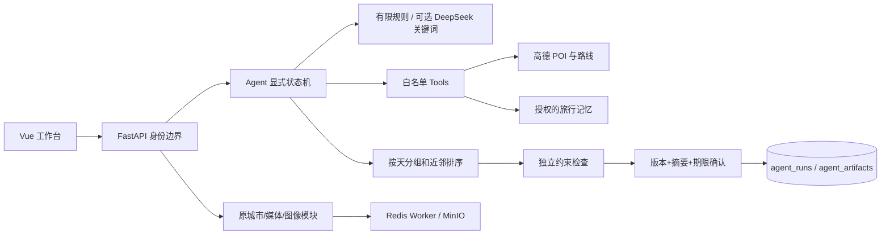

# Voyaura 软件架构与能力边界

当前补充：正式行程trips和结构化需求分析在owner认证边界挂载；0015合并两条0014迁移。见[交付说明](../HANDOFF.md)和[正式行程契约](../../docx/14-itinerary-api-apifox.md)。以下受控Agent架构仍有效。

本次交付延续原项目 Vue 3、TypeScript、FastAPI、SQLAlchemy、Alembic、PostgreSQL、Redis、MinIO 体系，增加受控旅行工作流。SQLite只用于本机与自动化验收；本机没有Docker，未声称生产服务联调通过。

## 用户价值与链路

旅行前：描述目标并确认城市、日期、预算、交通与节奏 → 授权地图或主动提供地点 → 按天组织 → 查看来源、时间线、未知项 → 调整 → 服务端预览 → 明确确认保存。
旅行后：选择城市及1—4天日期窗口 → 主动授权读取自己的记录 → 整理日期、文字、ready/clean影像数量 → 编辑 → 重新检查来源与版本 → 明确确认 → 独立私有故事快照。

## 模块与职责

| 代码 | 职责 |
| --- | --- |
| `api/app/auth.py` | 单机owner令牌、服务端actor、旧username输入复核；默认拒绝 |
| `api/app/agent/schemas.py` | 严格输入类型、有限坐标、日期时间/授权规则，拒绝额外字段 |
| `agent/tools.py` | 白名单工具、来源、查询时间、最多2次调用与错误记录、可选关键词模型 |
| `agent/planner.py` | 按天候选分组、近邻顺序、时间传播；独立验证器检查最后时间线 |
| `agent/service.py` | 持久化、幂等、编辑版本、租约恢复、来源变化撤回、确认CAS与档案写入 |
| `agent/models.py` / 迁移0014 | 新增任务与正式私有档案表；保留原13个迁移和业务数据 |
| `routers/agent.py` | 创建/列表/读取/编辑/确认预览/保存/能力查询 |
| `web/src/views/AgentWorkspace.vue` | 输入、日程、故事编辑、来源/未知/错误、执行记录、恢复与确认 |
| `AgentRouteMap.vue` | 授权且配置JS Key时加载高德；否则明确标示坐标示意，不冒充导航 |
| `ConnectionPanel.vue` / `api/session.ts` | 当前标签页凭证；不写URL/localStorage，不传给对象存储 |

## 数据与状态

`agent_runs` 保存 actor、client_request_id、输入摘要、kind、status、revision、请求/结果快照、事件、确认摘要与期限；用户＋请求号唯一。`agent_artifacts` 保存用户、run、kind、标题、独立内容快照、确认摘要和未知条件声明；run唯一，防止重复确认多次写入。

状态为 `running → needs_input / awaiting_confirmation / failed → confirmed`。信息不足与硬冲突不能确认；条件草案必须额外认可未知信息。编辑按expected_revision进行CAS更新，旧确认失效。确认token只存哈希，绑定用户、任务、版本、内容摘要及有效期（默认10分钟）。确认CAS与唯一约束已测试，包括并发两线程只写一份。

运行请求先持久化running，工具事件在完成阶段一起持久化；不是实时流式日志。默认5分钟执行租约，到期后GET/列表/同请求重试会终结为failed并记录恢复原因；不自动重做可能收费的外部调用，迟到执行不能覆盖恢复后的状态。

## 事实门禁与规划范围

- 地点分为高德已核验候选与user_provided候选。高德候选要求POI ID、行政区、有限GCJ-02坐标和查询时间；用户输入始终保留未经独立核验标签，并去重保留必去标记。
- 大模型只可提取最多3个检索关键词，不能输出业务事实或任意工具。表单约束优先；默认只是有限关键词规则，不宣称通用自然语言理解。模型固定DeepSeek端点，需服务端启用/密钥和本次外部/模型双授权。
- 每次最多4天、12候选、3个检索主题；使用远点种子、容量感知分组和日内近邻，不宣称完整k-medoids、ILS、最优解或学术创新已证明。
- 高德交通缺失、非有限或非正耗时保持未知；时间线可留明确30分钟缓冲，缓冲不是交通事实。第一站按用户开始时间，不称Provider事实。
- 验证器独立检查重复地点、必去、每日结束、已知开放窗口、时间传播和景点费用下界。票价未知不按免费处理。住宿、餐饮、预约余量和完整往返未纳入；所以旅行结果保持conditional。

## 隐私、失败与依赖

故事只读取actor名下、所选城市与日期的最多40条记忆及ready/clean媒体元数据，不读取照片内容，不外传故事。未确认草案来源文字或媒体指纹变化会撤回正文并使确认失效；**已确认故事是独立快照，删除来源不会自动删除档案**，尚无全部派生资料一键删除功能。

本次没有购买、公开发布或删除工具。外部调用默认关闭；地图调用可能消耗额度，模型可能收费，界面分别明确授权。云服务错误、签名/配额错误和配置缺失不会变为伪成功。

当前身份是单机共享owner令牌，不是完整多人登录。原媒体队列仍缺ACK/lease；旧删除仍有数据库与对象存储跨事务风险；真实PostgreSQL下来源变更与确认的完整竞态隔离仍需专门集成测试。这些限制使本交付适合本机受控验证，不应直接宣传为多人生产系统。

## 第三轮前端导航补充

`/journey/map` 为足迹与城市档案；`/journey/stories` 为城市记忆索引；`/journey/stories?compose=story&city=<adcode>&date=<YYYY-MM-DD>` 为故事编辑入口。URL只承载城市／日期，不携带私人正文或访问令牌。进入编辑不自动授权读取；`/studio` 展示真实作品历史及源照片关联。

手动六城索引是前端提供的用户输入选项，复用原manual-preview／manual-confirm，来源保留manual，不替代在线定位。所有数据写入和删除继续通过原确认流程。`useDialogFocus` 管理本轮到访、文字编辑与城市档案键盘焦点；嵌套编辑时底层档案设为inert，避免双重焦点陷阱。

## 第四轮档案与导航

`/account` 使用现有概览、任务列表与配置接口。访客仅加载本地引导；工作台在连接身份前不挂载，避免未授权预读。最近任务通过run参数读取持久化原记录，恢复输入但不恢复外部／记忆授权或确认凭据。未登录直达路径由本地路由保留，验证后恢复。

App管理导航保护，工作台与文字编辑器报告未提交状态；取消离开不改变页面，主动放弃后才提交路由。beforeunload补充刷新／关窗保护，正文没有新增浏览器持久化副本。嵌套提醒令底层编辑器inert，useDialogFocus仅处理当前活动对话框。
